<div align="center">


# rulecast

Your project conventions, enforced.

[](https://www.npmjs.com/package/@syv-ai/rulecast) [](https://github.com/syv-ai/rulecast/actions/workflows/ci.yml) [](LICENSE) [](https://syv-ai.github.io/rulecast/)

[Documentation](https://syv-ai.github.io/rulecast/) · [Getting started](#getting-started) · [Claude Code plugin](guides/claude-code-plugin.md) · [Changelog](packages/rulecast/CHANGELOG.md)

</div>

Your conventions are fragmented across `AGENTS.md` agent memories, `/docs`, specs, linter rules and old agent transcripts. Your coding agent is sort of aware of some of it. For the stuff it does know, it read it forty tool calls ago and keeps forgetting. Rulecast helps formalize conventions as rules and enforce them through agent hooks: when an edit breaks a rule, the agent is informed along with the relevant doc section, in the same turn.

<div align="center">



</div>

<details>
<summary>The same output as text</summary>

```
rulecast: 1 rule violated in app/services/users.py

error backend/no-httpexception
  app/services/users.py:2 raises HTTPException(404) in the service layer. Raise a domain exception; the API layer maps it to a response.

--- conventions/backend.md#errors ---
## Errors

Services raise domain exceptions. `app/api/errors.py` maps each one to a status code.
```

</details>

## Getting started

In Claude Code:

```text
/plugin install rulecast --marketplace syv-ai/rulecast
/rulecast:setup
```

With another agent, paste this:

```text
Set up rulecast in this project with me. Read
https://syv-ai.github.io/rulecast/agents/SETUP.md
and follow it.
```

The agent reads your repo, agent memories, docs and grills you a bit on the project's context. It will then serve you some relevant default rules, e.g., via linters, git hooks, for generated code and so on. You add what you agree with.

The agent hooks run in Claude Code today. Another agent can set up the same rules for git hooks and CI.

Ever tried to sit down and write your Christmas wish list? It's difficult, isn't it? Conventions are the same way. Most rules come later, one at a time: when the agent makes a mistake that shouldn't happen again, run `/rulecast:add-rule`.


## A rule

Rules live in `.rulecast-config.yaml`:

```yaml
repos:
  - repo: local
    rules:
      - id: backend/no-httpexception
        name: Services raise domain exceptions, not HTTPException
        files: '^app/services/.*\.py$'
        detect:
          regex:
            pattern: 'raise\s+HTTPException\((?<args>[^)]*)\)'
        message: "{{file}}:{{line}} raises HTTPException({{args}}) in the service layer. Raise a domain exception; the API layer maps it to a response."
        context:
          - "@conventions/backend.md#errors"
```

- `files` selects what the rule applies to; `detect` names a detector.
- `message` is what the agent reads. Named capture groups become template variables.
- `context` is the doc section delivered with the finding.

More in [Writing rules](guides/writing-rules.md): refusing a write, linters with their docs, turning a rule off.

## Detectors

| Detector | Catches | Default stages |
|---|---|---|
| `regex` | A pattern in the file's text | `edit, verify` |
| `path` | The file's path alone: "never edit `src/client/`" | `edit, verify` |
| `ast-grep` | Structure, not text: a call shape, a swallowed exception | `edit, verify` |
| `command` | Whatever a tool or script reports (SARIF, JSON, checkstyle, `file:line:` lines…): type checkers, dead-code finders, scanners [by config](agents/reference/tool-recipes.md) | `edit, verify`; `verify` with `scope: project` |
| `hook` | A hook your `.pre-commit-config.yaml` or `lefthook.yml` already declares | `verify` |
| `linter` | Errors from ruff, oxlint, eslint or gitleaks under the project's own config, each with its doc section | `edit, verify`; `verify` for eslint |
| `llm` | Conventions nothing mechanical expresses, judged by a model. Opt-in | `verify` |

`verify` runs when the agent stops; a rule can opt into the edit hook with `stages: [edit, verify]`. See [`agents/reference/detectors.md`](agents/reference/detectors.md).

## Commands

| Command | Does |
|---|---|
| `rulecast init` | Set rulecast up: config, settings, your existing git hooks as rules, agent hooks |
| `rulecast install` / `uninstall` | Add (or upgrade) the agent hooks and fetch missing rule repos, or remove the hooks |
| `rulecast run` | Check staged files (the default), changed files, or everything |
| `rulecast fix` | Apply regex and ast-grep rules' fixes; `--dry-run` prints the diff |
| `rulecast list` | Show every configured rule: where it comes from, what it matches, what it cites |
| `rulecast add` | Add catalog rules or packs, such as loop-safety, to the nearest config |
| `rulecast test` | Run each rule's good/bad examples; `--against` and `--history` say how much it would flag |
| `rulecast stats` | Per-rule outcomes from agent sessions: fired, fixed, ignored, noisy |
| `rulecast validate` | Check the config (and a rules manifest) and print diagnostics |
| `rulecast doctor` | Compile, check the environment and hooks, dry-run every rule; exits 2 on errors, and with `--ci` also on a setup that would run degraded |

If a rule is configured but quiet, `rulecast doctor` says why. `rulecast help --all` lists every command. The [advanced commands](guides/commands.md) and the exit codes are [there](guides/commands.md#exit-codes).

## Install

The agent hooks run `.claude/hooks/rulecast.sh`, a short script `rulecast install` writes and you commit with `.claude/settings.json`. It runs the project's `node_modules/.bin/rulecast`, else `rulecast` on the PATH, else `rulecast` in the directory `install.sh` installs to (`$RULECAST_INSTALL_DIR`, else `$XDG_BIN_HOME`, else `~/.local/bin`), for an agent started from the Dock or an IDE, whose PATH may lack it. Nothing installs rulecast behind your back. Linux and macOS; Windows is not supported.

Setup installs rulecast for you, after you approve the command. To do it by hand:

### Standalone binary

No Node needed. Installs the latest release as `~/.local/bin/rulecast` and puts it on your PATH, as uv's installer does:

```sh
curl -LsSf https://syv-ai.github.io/rulecast/install.sh | sh
```

In a terminal it shows what it will do and asks to proceed, customize (directory, startup files) or cancel; with no terminal it uses the defaults. It checks the download against its checksum and prints every shell startup file it changed. For a fixed version, use the script attached to that release: `https://github.com/syv-ai/rulecast/releases/download/vX.Y.Z/install.sh`. Options go after `sh -s --`: `-y` asks nothing, `--install-dir DIR` picks another directory, `--no-modify-path` changes no startup file, `--help` lists them. Run it again to update.

### npm

For one pinned version for everyone (needs Node ≥ 20.12):

```sh
pnpm add -D @syv-ai/rulecast     # or npm / yarn
```

## Performance

The edit hook is budgeted at p95 under 500 ms on a 30-rule project with warm caches, `llm` rules aside, and the hook before each Bash call at 150 ms over a hook that does nothing. `pnpm perf` checks both. There is no daemon: every hook is a fresh process with caches on disk.

## Learn more

- [Git hooks and CI](guides/git-hooks-ci.md): the same rules in pre-commit, pre-push and GitHub Actions
- [Adopting a rule on a codebase that already breaks it](guides/adopting-rules.md)
- [Agents](guides/agents.md) and the [Claude Code plugin](guides/claude-code-plugin.md)
- [Advanced](guides/advanced.md): several agents at once, fresh CI environments, committed baselines, unattended loops
- Reference: [rule format](agents/reference/rule-format.md), [detectors](agents/reference/detectors.md), [output and finding ids](agents/reference/output.md)

## Status

0.12. Everything above works and is tested. Before 1.0 the config format and the output of `rulecast run` may still change; `minimum_rulecast_version` exists so a rule can say what it needs.

Next: adapters for Codex, Cursor and OpenCode; Biome; an Azure OpenAI provider.

## License

MIT. See [LICENSE](LICENSE).
