<!-- Generated from the repository README by `pnpm readme`. Do not edit by hand. -->

<div align="center">


# rulecast

Your project's conventions, checked while your coding agent works.

[](https://www.npmjs.com/package/@syv-ai/rulecast) [](https://github.com/syv-ai/rulecast/actions/workflows/ci.yml) [](https://github.com/syv-ai/rulecast/blob/main/LICENSE) [](https://syv-ai.github.io/rulecast/)

[Documentation](https://syv-ai.github.io/rulecast/) · [Getting started](#getting-started) · [Claude Code plugin](https://github.com/syv-ai/rulecast/blob/main/guides/agents.md#claude-code) · [Changelog](https://github.com/syv-ai/rulecast/blob/main/packages/rulecast/CHANGELOG.md)

</div>

Your conventions are spread across `AGENTS.md`, agent memories, `/docs`, specs and linter configs. Your agent read some of it forty tool calls ago, and forgets. rulecast turns conventions into rules and checks them in your agent's hooks: when an edit breaks one, the agent gets the finding and the doc section it cites, in the same turn.

<div align="center">



</div>

<details>
<summary>The same output as text</summary>

```
rulecast: 1 rule violated in app/services/users.py

error backend/no-httpexception
  app/services/users.py:2 raises HTTPException(404) in the service layer. Raise a domain exception; the API layer maps it to a response.

--- conventions/backend.md#errors ---
## Errors

Services raise domain exceptions. `app/api/errors.py` maps each one to a status code.
```

</details>

## Getting started

In Claude Code:

```text
/plugin install rulecast --marketplace syv-ai/rulecast
/rulecast:setup
```

With another agent, paste this:

```text
Set up rulecast in this project with me. Read
https://syv-ai.github.io/rulecast/agents/SETUP.md
and follow it.
```

The agent reads your repo, docs and agent memories, then shows you one page: the rules that fit (from your linters, your git hooks, generated code) and the few questions only you can answer. Nothing is written until you approve.

The agent hooks run in Claude Code today. Another agent can set up the same rules for git hooks and CI.

Most rules come later, one at a time: when the agent makes a mistake that shouldn't happen again, run `/rulecast:add-rule`.

## A rule

Rules live in `.rulecast-config.yaml`:

```yaml
repos:
  - repo: local
    rules:
      - id: backend/no-httpexception
        name: Services raise domain exceptions, not HTTPException
        files: '^app/services/.*\.py$'
        detect:
          regex:
            pattern: 'raise\s+HTTPException\((?<args>[^)]*)\)'
        message: "{{file}}:{{line}} raises HTTPException({{args}}) in the service layer. Raise a domain exception; the API layer maps it to a response."
        context:
          - "@conventions/backend.md#errors"
```

- `files` selects what the rule applies to; `detect` names a detector.
- `message` is what the agent reads. Named capture groups become template variables.
- `context` is the doc section delivered with the finding.

More in [Writing rules](https://github.com/syv-ai/rulecast/blob/main/guides/writing-rules.md): refusing a write, linters with their docs, turning a rule off.

## Detectors

| Detector | Catches | Default stages |
|---|---|---|
| `linter` | Errors from ruff, oxlint, eslint or gitleaks under the project's own config, each with its doc section | `edit, verify`; `verify` for eslint |
| `command` | Whatever a tool or script reports (SARIF, JSON, checkstyle, `file:line:` lines…): type checkers, dead-code finders, scanners [by config](https://github.com/syv-ai/rulecast/blob/main/agents/reference/tool-recipes.md) | `edit, verify`; `verify` with `scope: project` |
| `hook` | A hook your `.pre-commit-config.yaml` or `lefthook.yml` already declares | `verify` |
| `ast-grep` | Structure, not text: a call shape, a swallowed exception | `edit, verify` |
| `regex` | A pattern in the file's text | `edit, verify` |
| `path` | The file's path alone: "never edit `src/client/`" | `edit, verify` |
| `llm` | Conventions nothing mechanical expresses, judged by a model. Opt-in | `verify` |

`verify` runs when the agent stops; a rule can opt into the edit hook with `stages: [edit, verify]`. See [`agents/reference/detectors.md`](https://github.com/syv-ai/rulecast/blob/main/agents/reference/detectors.md).

## Commands

| Command | Does |
|---|---|
| `rulecast init` | Set rulecast up: config, settings, your existing git hooks as rules, agent hooks |
| `rulecast install` / `uninstall` | Add (or upgrade) the agent hooks and fetch missing rule repos, or remove the hooks |
| `rulecast run` | Check staged files (the default), changed files, or everything |
| `rulecast fix` | Apply regex and ast-grep rules' fixes; `--dry-run` prints the diff |
| `rulecast list` | Show every configured rule: where it comes from, what it matches, what it cites |
| `rulecast add` | Add catalog rules or packs, such as loop-safety, to the nearest config |
| `rulecast test` | Run each rule's good/bad examples; `--against` and `--history` say how much it would flag |
| `rulecast stats` | Per-rule outcomes from agent sessions: fired, fixed, ignored, noisy |
| `rulecast validate` | Check the config (and a rules manifest) and print diagnostics |
| `rulecast doctor` | Compile, check the environment and hooks, dry-run every rule, size touch context; exits 2 on errors, and with `--ci` also on a setup that would run degraded |

If a rule is configured but quiet, `rulecast doctor` says why. `rulecast help --all` lists every command, and `rulecast <command> --help` its flags; the site's [Commands](https://syv-ai.github.io/rulecast/reference/commands/) page shows them all. The exit codes are in the [output contract](https://github.com/syv-ai/rulecast/blob/main/agents/reference/output.md#exit-codes).

## Install

Linux and macOS; Windows is not supported. Setup installs rulecast for you, after you approve the command, and nothing installs it behind your back. [How it works](https://syv-ai.github.io/rulecast/how-it-works/#what-gets-written) lists what setup writes and where the agent hooks look for rulecast. To install it by hand:

### Standalone binary

No Node needed. Installs the latest release as `~/.local/bin/rulecast` and puts it on your PATH:

```sh
curl -LsSf https://syv-ai.github.io/rulecast/install.sh | sh
```

It checks the download's checksum and lists any shell startup file it changed. Run it again to update. `sh -s -- --help` lists its options. For a fixed version, use the `install.sh` attached to that release. The binary unpacks its native files into `native/` in rulecast's cache home (`~/.cache/rulecast` by default), or into a private temp directory when that can't be written.

### npm

For one pinned version for everyone (needs Node ≥ 20.12):

```sh
pnpm add -D @syv-ai/rulecast     # or npm / yarn
```

## Performance

The edit hook is budgeted at p95 under 500 ms on a 30-rule project with warm caches, `llm` rules aside, and the hook before each Bash call at 150 ms over a hook that does nothing. The repo's perf test checks both. There is no daemon: every hook is a fresh process with caches on disk. When a session starts, the hook runs `rulecast warm` for the detectors that have warm-up work; no built-in detector has any yet.

## Learn more

- [Git hooks and CI](https://github.com/syv-ai/rulecast/blob/main/guides/git-hooks-ci.md): the same rules in pre-commit, pre-push and GitHub Actions
- [Adopting a rule on a codebase that already breaks it](https://github.com/syv-ai/rulecast/blob/main/guides/adopting-rules.md)
- [Using it with your agent](https://github.com/syv-ai/rulecast/blob/main/guides/agents.md): the Claude Code plugin, other agents, and what the agent gets wrong
- [Several agents and git](https://github.com/syv-ai/rulecast/blob/main/guides/advanced.md) and [agent loops](https://github.com/syv-ai/rulecast/blob/main/agents/reference/loops.md)
- Reference: [rule format](https://github.com/syv-ai/rulecast/blob/main/agents/reference/rule-format.md), [detectors](https://github.com/syv-ai/rulecast/blob/main/agents/reference/detectors.md), [output and finding ids](https://github.com/syv-ai/rulecast/blob/main/agents/reference/output.md)

## Status

0.14. Before 1.0 the config format and `rulecast run`'s output may change.

Next: adapters for Codex, Cursor and OpenCode; Biome; an Azure OpenAI provider.

## License

MIT. See [LICENSE](https://github.com/syv-ai/rulecast/blob/main/LICENSE).
